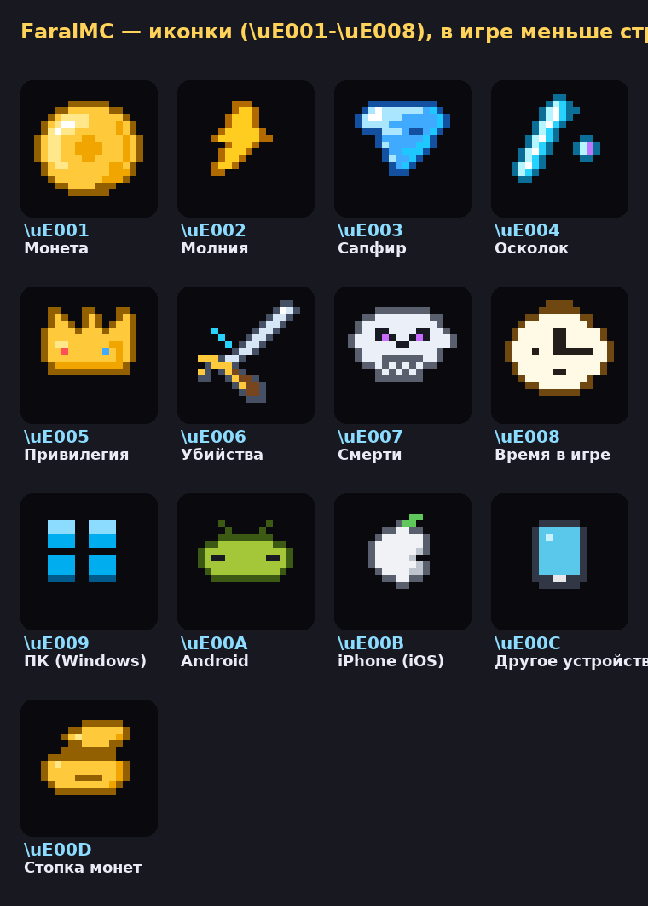
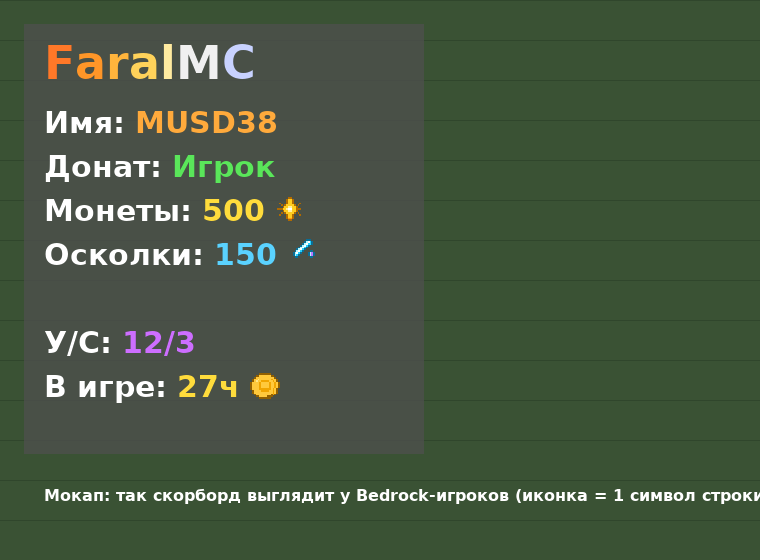

# GeyserPlugins — плагины FaralMC под Geyser/Floodgate

Плагины пишутся **исключительно для Bedrock-игроков**: связка Purpur 26.2 (ядро на Java 25) +
Geyser + Floodgate. **С Java заходить нельзя** — FaralTab кикает любого игрока без Floodgate
(`bedrock-only` в конфиге), поэтому никаких Java-заглушек вместо иконок в проекте нет:
у всех игроков Bedrock, у всех стоит ресурспак.

## FaralTab — таб / скорборд с кастомными иконками

При входе — большой синий заголовок **FaralMC** на весь экран (`join-title:` в конфиге), а в игре оформление как на референсе (сервер **FaralMC**): компактная тёмная панель,
градиентный заголовок, монеты, осколки, привилегия, У/С и время в игре.
Иконка занимает ровно **один символ строки** — скорборд не становится большим.





Что показывает (всё настраивается в `FaralTab/src/main/resources/config.yml`):

| Строка | Источник |
|---|---|
| Имя | ник игрока |
| Донат (привилегия) | LuckPerms (или Vault Permission), названия групп — в `groups:` конфига |
| Монеты | Vault Economy (EssentialsX и т.п.) |
| Осколки | **PlayerPoints** |
| У/С | статистика: убийства / смерти (+ `{kd}`) |
| В игре | статистика времени, часы (`{playtime_hours}`, `{playtime}`) |
| Устройство | значок платформы из Floodgate перед ником: `{device_icon}` (`{device}` — название) |

**Ник над головой:** перед ником — значок устройства (Windows / Android / iPhone / другое),
под ником — здоровье с красным сердечком. В невидимости ник и здоровье прячет сама игра.
Настройки — секция `nametag:` в config.yml.

#
## FaralItems — кастомные предметы

Как на FunTime: **трапка** (ПКМ — клетка 3×3 вокруг ближайшего игрока: плачущий
обсидиан + позолоченный чернит, светильник в потолке; ломать её нельзя, ставить
блоки внутри нельзя, через время рассыпается), **явная пыль** (свечение и снятие
невидимости в радиусе), **дезориентация** (слепота, тошнота, замедление и
разворот экрана врагам), **лом спавнеров** (одноразовый: ломает спавнер и отдаёт
его с тем же мобом), **особые зелья** (Сила III + Скорость III и др.).

Запретные зоны в config.yml: миры целиком и регионы **WorldGuard** — там предметы
не работают, кроме зелий. Получение: `/items` у админа (клик выдаёт) и крафты
на верстаке. Всё настраивается в config.yml: названия, материалы, радиусы,
время, кулдауны, эффекты, рецепты, скин клетки трапки.

## Установка

1. **Плагин:** скачайте `FaralTab-1.12.3.jar` из [артефактов GitHub Actions](../../actions)
   (вкладка Actions → последний запуск → `FaralMC-release`) → в `plugins/` Purpur 26.2.
   Для всех функций поставьте рядом: **Vault** + экономика, **PlayerPoints**, **LuckPerms**
   (всё это softdepend — без них плагин стартует, строки покажут `defaults:` из конфига).
2. **Ресурспак:** `FaralResourcePack.mcpack` → в `plugins/Geyser-Spigot/packs/`, рестарт.
   В конфиге Geyser поставьте **`force-resource-packs: true`** — без пака игрок не зайдёт,
   а иконки не превратятся в пустоту. Подробнее: [FaralResourcePack/README.md](FaralResourcePack/README.md).
3. Перезагрузка конфига на лету: `/faraltab reload`. Скрыть/показать таб: `/faraltab toggle`.

### Команды и права

| Команда | Право | Что делает |
|---|---|---|
| `/faraltab reload` | `faraltab.admin` (op) | перезагрузить config.yml |
| `/faraltab toggle [игрок]` | `faraltab.toggle` (всем) / `faraltab.admin` для чужих | вкл/выкл скорборд |
| `/faraltab on / off` | то же | явно включить/выключить |

Обход bedrock-only для тестов админа — право `faraltab.bedrock-bypass`
(по умолчанию нет ни у кого, даже у опов; выдаётся вручную в LuckPerms).

### Сборка вручную

```bash
cd FaralTab && mvn package        # нужен JDK 25, jar в target/
python3 tools/build_mcpack.py     # FaralResourcePack.mcpack в корне
python3 tools/make_icons.py       # перегенерация иконок и превью
```

> Если в Maven-репозитории Purpur ещё нет `purpur-api 26.2-R0.1-SNAPSHOT`,
> в `FaralTab/pom.xml` замените зависимость на
> `io.papermc.paper:paper-api:26.2-R0.1-SNAPSHOT (у Purpur схема версий своя: 26.2.build.<номер>-stable, CI подбирает номер сам)` — плагин использует только
> стандартный Bukkit/Paper API и на Purpur работает так же.

## FaralTalismans — талисманы как на FunTime

Талисман — предмет в левой руке (в инвентаре не работает), даёт **плюсы и минусы к характеристикам**,
выдаётся админом или крафтится. Под Bedrock оставлены только характеристики, которые
там реально есть: урон, защита, здоровье, скорость (без "твёрдости брони"
и "скорости атаки" — в Bedrock их нет). 12 талисманов с простыми именами:
воина, берсерка, героя, убийцы, ярости, бегуна, демона, танка, стража,
жизни, охотника, странника. **Всё настраивается в config.yml**:
названия, материалы, лор (автолор `{stats}`), плюсы/минусы и числа, цены,
место ношения, права, рецепты крафта, тексты, цвета, звуки; можно
отключать (`enabled: false`) и добавлять свои.

| Команда | Что делает |
|---|---|
| `/talisman` | только админы: меню талисманов, клик по талисману выдаёт его тебе |

Талисман опознаётся по скрытой PDC-метке (не подделать переименованием),
одинаковые не стакаются, при убирании бонусы и атрибуты снимаются,
о включении/выключении плагин пишет в чат и играет звук (настраивается).

## Структура репозитория

```
FaralTab/               скорборд и ник (Maven, Java 25, api-version 26.2)
FaralTalismans/         талисманы как на FunTime (Maven, Java 25, api-version 26.2)
FaralResourcePack/      исходники Bedrock-пака (manifest.json, font/glyph_E0.png)
FaralResourcePack.mcpack  готовый пак для Geyser (папка packs/)
preview/                превью иконок и мокап скорборда
tools/                  генераторы иконок и сборщик .mcpack
.github/workflows/      CI: собирает jar + mcpack в артефакты при каждом пуше
```
